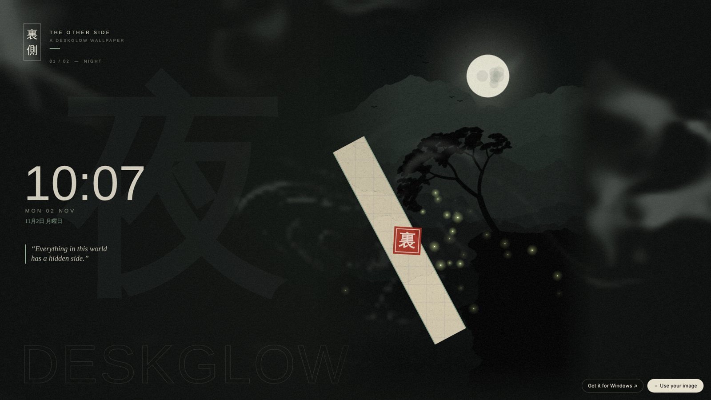
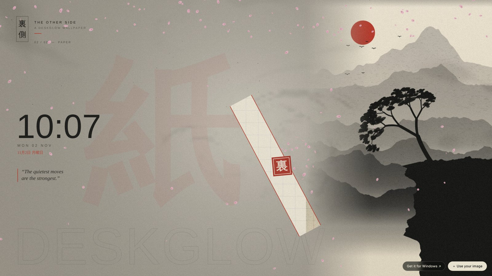
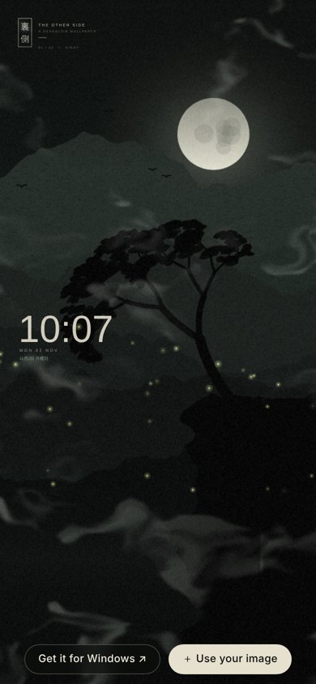
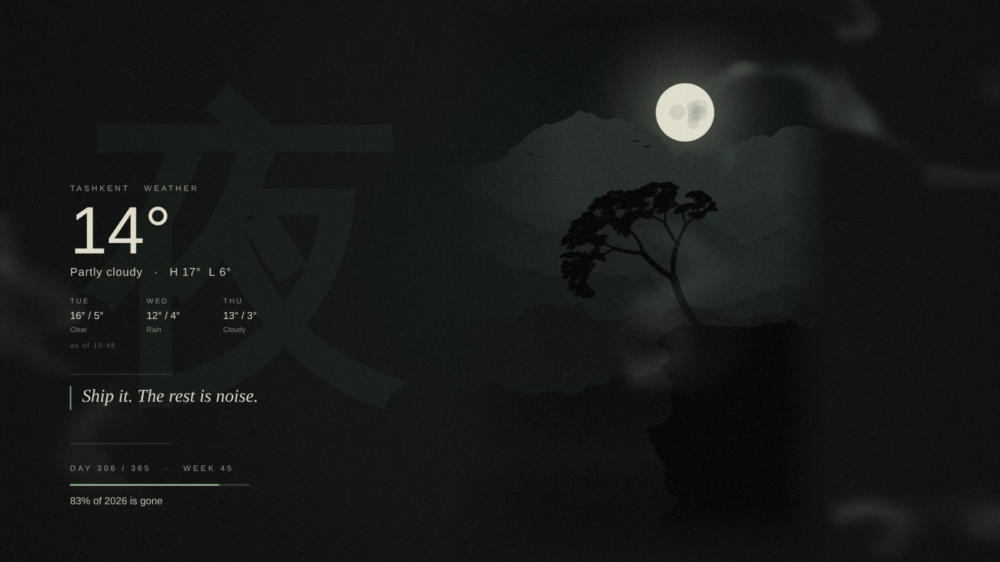

# Deskglow

Free, open-source live wallpapers for Windows. A wallpaper is just a web page (HTML + JavaScript) that runs **behind your desktop icons**, and it reacts to your mouse.



**▶ Try it in your browser:** https://drugenemy.github.io/deskglow/ura/
Move the mouse, click, double-click, or drop in your own image.

**⬇ Download for Windows:** [latest release](https://github.com/drugenemy/deskglow/releases/latest)

---

## What's inside

**The engine** — a small tray app (C#, .NET 8, WebView2):

- Puts any HTML page behind the desktop icons, across all monitors
- Sends your mouse moves and clicks to the wallpaper, so it can be interactive
- Pauses by itself when a full-screen app or game covers the screen
- Tray menu: pick a wallpaper, pause, reload, start with Windows

**裏 ura** — the main wallpaper. *"Everything has a hidden side."*

- Diagonal bands sweep across the screen. A full sweep swaps the scene underneath.
- A slit under your mouse shows a pencil sketch hidden under the art. The code draws this sketch from your image by itself.
- Smoke you can push with the mouse, plus fireflies, sparks, petals or ash
- The art moves with depth (parallax). Click for a 裏 seal stamp. Double-click for the next scene.
- A clock with the date in English and Japanese
- **Bring your own images:** it picks the colors from your art by itself

| Paper scene | On a phone |
|---|---|
|  |  |

**demo** — glowing particles that follow the mouse.

**Lock screen with widgets** — Windows does not allow live content on the lock screen, so Deskglow makes a still picture of your wallpaper and puts widgets on it:

- **Weather** for your city: now, today's high/low, the next 3 days (free data from [Open-Meteo](https://open-meteo.com), no account)
- **Your note**: a short line you write yourself
- **Year progress**: day, week, and how much of the year is gone

It refreshes every 30 minutes and right after you unlock, so it is fresh the next time you lock. The widgets take the wallpaper's colors and sit on the side away from the art. Turn it on in the tray menu: **Lock screen → Use wallpaper as lock screen**.



---

## Install (Windows 10 / 11)

1. Download `Deskglow-win-x64.zip` from [Releases](https://github.com/drugenemy/deskglow/releases/latest) and unzip it anywhere.
2. Run `Deskglow.exe`.
   Windows may say *"Windows protected your PC"* because the app is not signed. Click **More info → Run anyway**.
3. A tray icon appears (bottom right, maybe under the `^` arrow).
   **Left click** = pause / resume. **Right click** = menu.

If the wallpaper stays black on Windows 11 24H2: right-click the tray icon → **Black screen fix**.

## Make it yours

Open `wallpapers/ura/`:

1. Put your images in `img/` (portrait images work best).
2. Open `scenes.js` and list them. Only `img` is required:
   ```js
   scenes: [
     { img: 'img/my-art.jpg' },
     { img: 'img/other.png', title: '月', label: 'MOON', fx: 'petals' },
   ],
   ```
3. Right-click the tray icon → **Reload**.

Every option is explained at the top of `scenes.js`: text, colors, effects (`pipe` smoke, `embers`, `fireflies`, `petals`, `ash`), and where the art sits.

**Your own wallpaper from scratch:** make a folder in `wallpapers/` with an `index.html`. Normal `mousemove` / `click` events work. You also get `window.deskglow.paused` and `deskglow.on('pause' | 'resume', fn)`.

For a nicer lock screen, a wallpaper can also define:

```js
deskglow.drawLockBackground = (ctx, w, h) => { /* draw a clean still frame, no clock */ };
deskglow.lockTheme = () => ({ side: 'left', fg: '#ece6d6', accent: '#8fae93', light: false });
```

Without these, Deskglow uses a screenshot of the wallpaper.

> Only share images you have the right to share. Fan art and official art belong to their creators. Keeping them on your own PC is your call; putting them in a public repo or a download is not.

## Build from source

Needs the [.NET 8 SDK](https://dotnet.microsoft.com/download). It builds on Windows, macOS or Linux:

```bash
dotnet publish src/Deskglow.csproj -c Release -r win-x64 --self-contained true -p:PublishSingleFile=true -p:IncludeNativeLibrariesForSelfExtract=true -o out
```

To try a wallpaper in the browser, serve the folder and open it:

```bash
cd wallpapers && python3 -m http.server 8000
```

## How it works

Windows draws desktop icons in a window called `SHELLDLL_DefView`. Sending the message `0x052C` to `Progman` makes Explorer create a `WorkerW` layer between the wallpaper and the icons. Deskglow puts a borderless WebView2 window into that layer (`src/Desktop.cs`). The icons sit on top and catch the mouse, so the app reads the cursor itself and passes it to the page as normal DOM events (`src/Bridge.cs`).

## License

MIT. The ink artwork in `wallpapers/ura/img/` was generated by code for this project and is under the same license.
